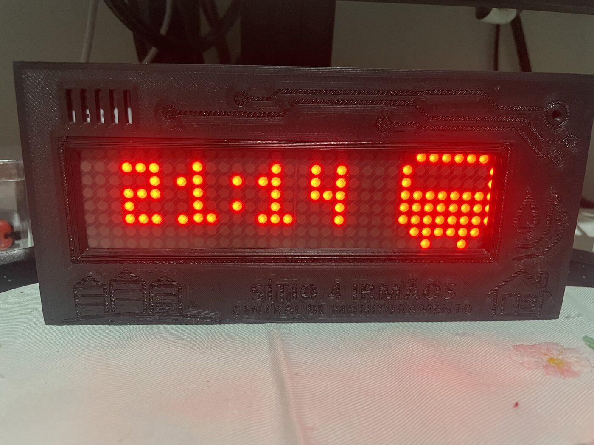
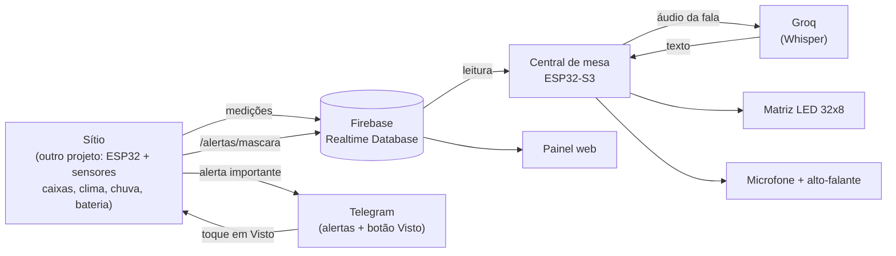
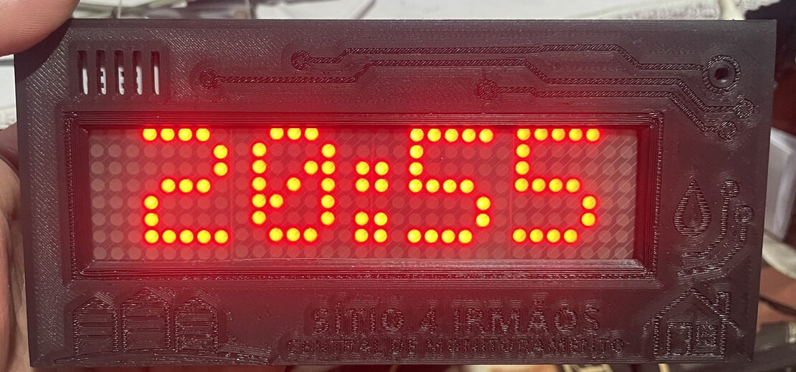
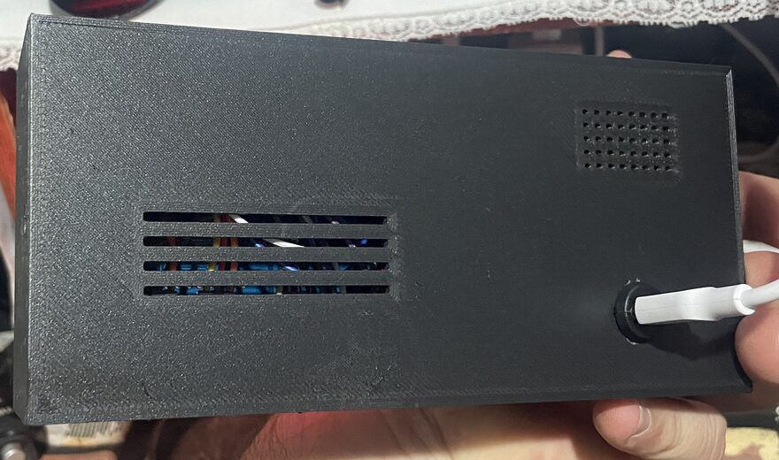
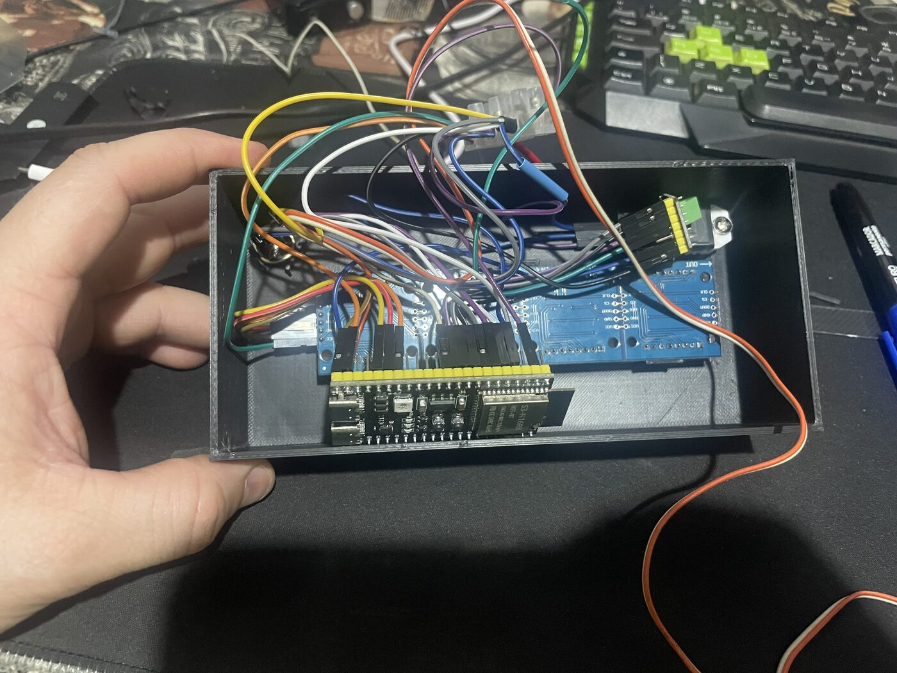
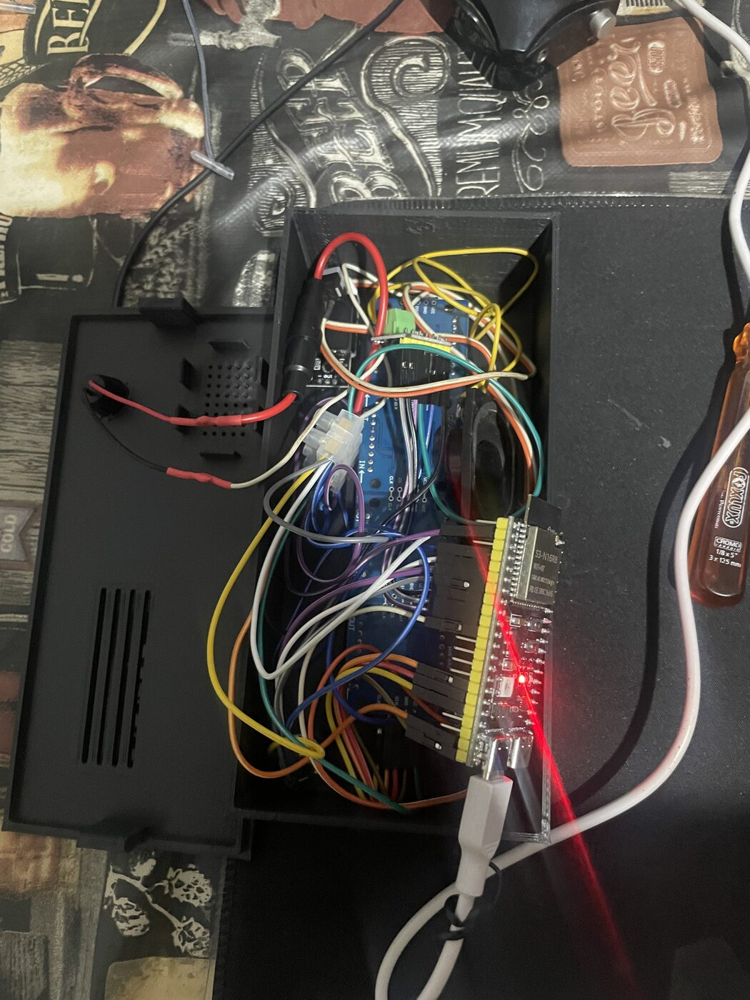
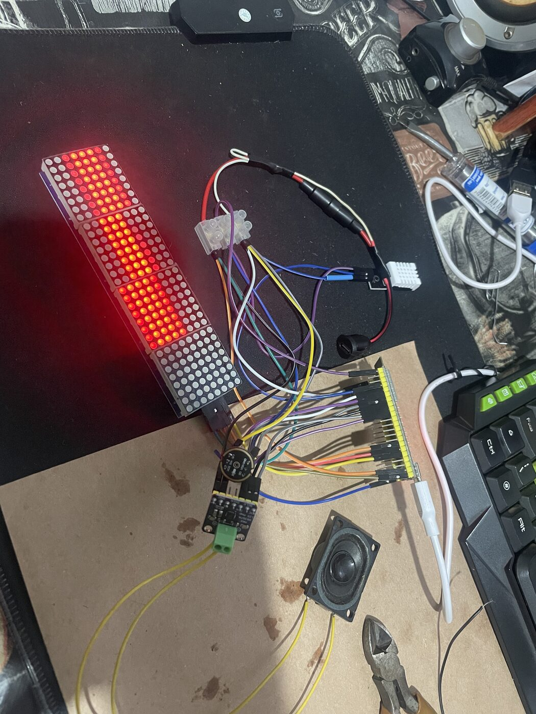
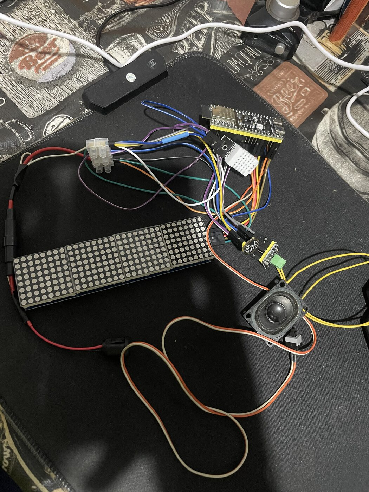
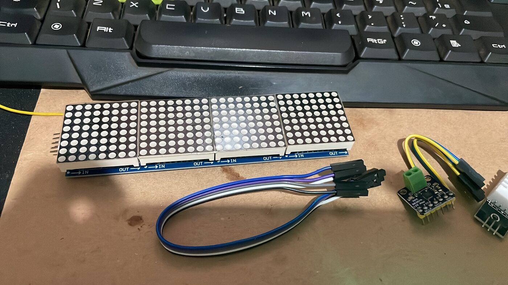
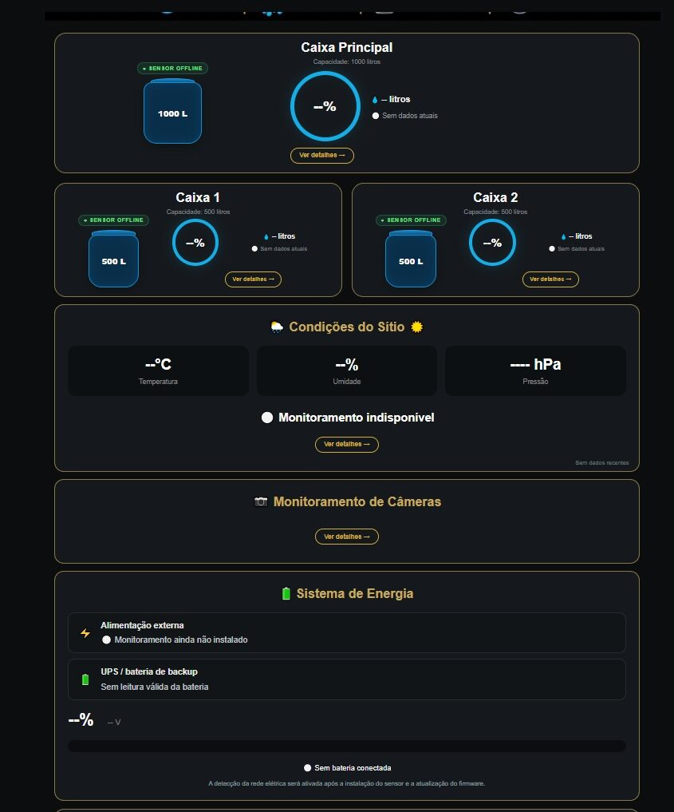

# Central de Monitoramento — Sítio 4 Irmãos

Central de mesa com **ESP32-S3**, matriz de LED e **assistente de voz** que mostra e conta, sem precisar abrir o celular, como estão as caixas d'água, o clima e a energia do sítio.



> Projeto caseiro, feito para uso real em um sítio. O código está em português e comentado, pensado para quem quer aprender e adaptar.

## O que ela faz

- **Mostra a hora, a temperatura e a umidade** do ambiente (sensor DHT22) numa matriz de LED 32×8.
- **Ronda automática do sítio:** a cada 10 minutos, sozinha, passa no visor o nível das caixas, a temperatura, a umidade, a pressão e a condição do tempo no sítio. Dado velho ou indisponível é pulado.
- **Responde por voz.** Você aperta o botão e fala; ela transcreve a fala, entende o comando e responde falando e escrevendo no visor. (Também dá para ativar dizendo "central" + "ativar", com um modelo do Edge Impulse; veja abaixo.)
- **Ícone de alerta fixo na matriz:** quando o sítio avisa um problema, um ícone de 8×8 pontos fica piscando no canto, em cima de qualquer coisa que esteja passando, até você tocar em **"Visto"** no Telegram:

  | Ícone | Significa |
  |:--:|---|
  | caixa d'água | caixa baixa / queda de nível |
  | pilha | bateria fraca |
  | wifi cortado | internet fora (também acende sozinho se ficar 5 min sem dados do sítio) |
  | casinha | alerta geral do sítio |

- **Dados sempre frescos:** se você pergunta algo do sítio e o dado está velho, ela lê de novo no Firebase antes de responder.
- **Apaga o visor de madrugada** (configurável) e usa brilho baixo em repouso.
- **Vários Wi-Fi:** tenta as redes da lista, em ordem, e reconecta sozinha.

## Como funciona



1. O projeto do **sítio** mede as caixas, o clima, a chuva e a bateria e grava tudo no **Firebase**.
2. A **central** lê o Firebase e mostra/fala os dados.
3. Quando algo importante acontece, o sítio manda uma mensagem no **Telegram** com o botão **"✅ Visto"** e grava o alerta em `/alertas/mascara`. A central acende o ícone. Ao tocar em "Visto", o sítio zera o alerta e o ícone some.
4. A fala vai para a **Groq (Whisper)**, que devolve o texto. A resposta é falada com voz sintetizada (TTS) pela biblioteca ESP32-audioI2S.

Detalhes da estrutura de dados em [`docs/firebase-estrutura.md`](docs/firebase-estrutura.md).

## Fotos

| | |
|---|---|
|  |  |
| Central pronta mostrando a hora | Traseira: ventilação, grade do alto-falante e cabo de energia |
|  |  |
| Interior da case | Interior com a tampa aberta |
|  |  |
| Protótipo na bancada | Protótipo: fiação |



## Lista de peças

| Peça | Qtde | Observação |
|---|:--:|---|
| ESP32-S3 **N16R8** (16 MB de flash, 8 MB de PSRAM) | 1 | A PSRAM é necessária (o áudio é gravado nela) |
| Matriz de LED **MAX7219 4 em 1** (FC16, "HW-692") | 1 | 4 módulos de 8×8 em cadeia |
| Sensor **DHT22** (AM2302) | 1 | Temperatura e umidade do ambiente |
| Microfone **INMP441** (I²S) | 1 | |
| Amplificador **MAX98357A** (I²S) | 1 | |
| Alto-falante pequeno 4–8 Ω | 1 | Funciona com 8 Ω (um pouco menos de volume) |
| Botão de pressão | 1 | Ativa a central |
| Fonte **5 V** | 1 | Veja o aviso de alimentação abaixo |
| Fios, conector de emenda, case impressa em 3D | | |

> ⚠️ **Alimente pela fonte de 5 V, não pelo USB do computador.** Com a matriz acesa e o amplificador tocando, a corrente passa do que a porta USB entrega: a matriz acende só parte dos LEDs, o som some e a placa chega a reiniciar sozinha. O USB serve só para gravar o código e ver o Monitor Serial.

## Ligações

| Módulo | Pino do módulo | GPIO do ESP32-S3 |
|---|---|:--:|
| Matriz MAX7219 | CLK | 12 |
| | DIN | 11 |
| | CS | 10 |
| | VCC / GND | 5 V / GND |
| DHT22 | DATA | 4 |
| Microfone INMP441 | SCK | 5 |
| | WS | 6 |
| | SD | 7 |
| Amplificador MAX98357A | BCLK | 15 |
| | LRC | 16 |
| | DIN | 17 |
| | Vin / GND | 5 V / GND |
| Botão | um lado | 18 (usa o pull-up interno) |
| | outro lado | GND |

O alto-falante vai nos bornes **+** e **−** do MAX98357A (nunca no GND do ESP). Todos os GND (fonte, ESP, matriz e módulos) precisam estar ligados entre si.

Se quiser mudar algum pino: `display.h` (matriz), `sensores.h` (DHT22), `microfone.h` (microfone), `meu_audio.h` (alto-falante) e `botao.h` (botão).

## Bibliotecas

Instale pelo Gerenciador de Bibliotecas da Arduino IDE (ou do GitHub):

- **MD_Parola** e **MD_MAX72XX** (MajicDesigns) — matriz de LED
- **DHT sensor library** (Adafruit) — DHT22
- **FirebaseClient** (Mobizt) — Realtime Database
- **ESP32-audioI2S** (schreibfaul1) — som e voz
- **Edge Impulse** — só se quiser ativar por palavra (opcional, veja a seção abaixo)
- Pacote de placas **esp32** da Espressif (versão 3.x — o código usa o driver I²S novo, `driver/i2s_std.h`)

## Instalação

### 1. Configure a placa na Arduino IDE

Menu **Ferramentas**:

| Opção | Valor |
|---|---|
| Placa | `ESP32S3 Dev Module` |
| PSRAM | `OPI PSRAM` |
| Flash Size | `16MB (128Mb)` |
| Partition Scheme | `16M Flash (3MB APP/9.9MB FATFS)` |
| USB CDC On Boot | `Enabled` se o cabo estiver na entrada **USB**, `Disabled` se estiver na entrada **UART/COM** |

> O programa passa de 2 MB. Com o esquema de partição padrão (1,3 MB) a compilação falha com *"Sketch too big"*.

### 2. Segredos (senhas e chaves)

As senhas **não** estão no repositório. Na pasta `central_monitoramento/`:

1. Copie `firebase_secrets_exemplo.h` para **`firebase_secrets.h`** e preencha: URL do Realtime Database, chave de API do Firebase, e-mail e senha do usuário, e a chave da **Groq** (grátis em [console.groq.com](https://console.groq.com)).
2. Copie `wifi_redes_exemplo.h` para **`wifi_redes.h`** e coloque as suas redes Wi-Fi (2,4 GHz).


### 3. Palavra de ativação (opcional)

Por padrão a central é ativada **só pelo botão** (`#define ATIVACAO_POR_VOZ 0` no topo do `.ino`), e assim compila sem nenhuma biblioteca extra.


## Comandos de voz

Aperte o botão (ou, se você ativou a palavra de ativação, diga "central" + "ativar") e pergunte. Alguns exemplos:

| Você diz | Ela responde |
|---|---|
| "Qual o nível da caixa 1?" (também caixa 2 e principal) | Nível e litros |
| "Status das caixas" | Resumo de todas |
| "Qual a temperatura?" / "Qual a umidade?" | Do ambiente da central |
| "Qual a temperatura no sítio?" / "Umidade do sítio" / "Pressão" | Do sítio |
| "Está chovendo?" | Condição da chuva no sítio |
| "Que horas são?" | Hora certa |
| "Obrigado", "ok", "beleza" | Confirma |
| "Encerrar", "tchau", "pode parar" | Volta ao repouso |

As palavras reconhecidas ficam em `voz.h` e dá para acrescentar as suas.

## Testar os alertas sem o sítio

No Monitor Serial (115200), digite:

| Comando | Efeito |
|---|---|
| `alerta 1` | ícone da caixa d'água |
| `alerta 2` | ícone da pilha |
| `alerta 4` | ícone de internet |
| `alerta 8` | ícone da casinha |
| `alerta 15` | todos juntos (se revezam) |
| `alerta off` | desliga o teste (volta a obedecer ao Firebase) |

Se o ícone aparecer do lado errado, troque `ICONE_NA_DIREITA` em `display.h`; se aparecer de cabeça para baixo, troque `MATRIZ_INVERTE_VERTICAL`.

## Principais ajustes

| O quê | Onde |
|---|---|
| Intervalo da ronda do sítio (hoje 10 min) | `INTERVALO_RONDA_SITIO_MS` no `.ino` |
| Horário em que o visor apaga (hoje 0h às 8h) | `HORA_APAGAR` / `HORA_ACENDER` em `display.h` |
| Brilho | `BRILHO_BAIXO` / `BRILHO_ALTO` em `display.h` |
| Sensibilidade do microfone e silêncio para encerrar a fala | `microfone.h` |
| Quais caixas existem | `CAIXA_2_INSTALADA` / `CAIXA_PRINCIPAL_INSTALADA` em `voz.h` |

## Estrutura do código

```
central_monitoramento/
├── central_monitoramento.ino   programa principal (setup/loop, estados, ronda)
├── display.h                   matriz de LED, ícones de alerta, relógio pequeno
├── voz.h                       comandos de voz e textos das respostas
├── microfone.h                 gravação e transcrição (Groq / Whisper)
├── meu_audio.h                 alto-falante e voz
├── wake_word.h                 palavra de ativação (opcional, Edge Impulse)
├── botao.h                     botão físico
├── sensores.h                  DHT22
├── relogio.h                   hora por NTP
├── wifi_config.h               conexão Wi-Fi
├── dados_sitio.h               dados vindos do sítio e máscara de alertas
├── firebase_central.h          leitura do Firebase
├── firebase_secrets_exemplo.h  MODELO das chaves  (copie para firebase_secrets.h)
└── wifi_redes_exemplo.h        MODELO das redes   (copie para wifi_redes.h)
```

## Case 3D

Pasta [`case-3d/`](case-3d/): `case-central.scad` (fonte, feito no **OpenSCAD**), `case-central.stl` (corpo) e `tampa-central.stl` (tampa). Medidas externas de **170 × 80 × 45 mm**. A tampa assenta por cima e é presa por abas em "I" com um parafuso pela lateral; a case tem só uma covinha-guia, e o furo do parafuso é feito depois de imprimir, com a tampa encaixada.

Na primeira impressão as presilhas que seguram a matriz ficaram finas e a case ficou apertada: se for imprimir, vale deixar a presilha mais grossa e a case uns 2 cm mais larga.


## Projeto parceiro

Esta central só **lê** os dados. Quem mede e grava é o projeto do sítio (ESP32 com sensores de nível, clima, chuva e bateria, mais Telegram e painel web). 



## Agradecimentos

Este projeto foi idealizado, montado, testado e acompanhado por **Ricardo Zuliani**, com apoio do **ChatGPT (OpenAI)** e do **Claude (Anthropic)** no planejamento, organização do código, diagnóstico de problemas, documentação e preparação da publicação. A montagem física, as decisões finais e os testes no local são de responsabilidade do autor do projeto.


## Licença

[MIT](LICENSE). Faça, adapte e melhore à vontade.
